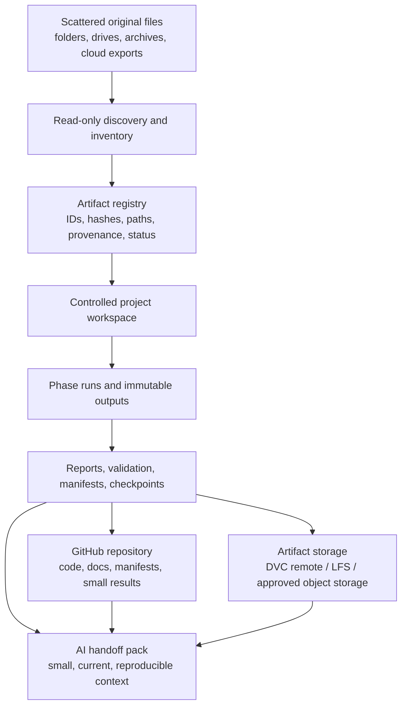

# ML CP — Resilient Implementation, Artifact Management, Knowledge Retention, and GitHub Plan

**Project title:** Domain-Specific Instruction-Tuning Dataset Curation Framework  
**Document type:** Master implementation and recovery plan  
**Plan version:** 2.0  
**Prepared:** 16 November 2026  
**Status:** Proposed operating plan; it is not evidence that the listed phases have been completed.

---

## 0. Executive direction

The previous workflow was too dependent on chat history and one-time uploads. Work could be completed in a conversation without leaving behind a reliable record of what was inspected, changed, generated, validated, or still missing. Large files were scattered across directories and archives, and the project state was difficult to reconstruct after the AI context window filled.

This plan changes the operating model:

> **The local project workspace, versioned repository, artifact registry, and phase records become the source of truth. Chat history becomes a temporary working interface—not project storage or project memory.**

Every work unit must leave a durable checkpoint before the next one begins. A phase is not complete merely because the analysis was discussed or a script ran. It is complete only when its outputs, run record, validation results, known gaps, updated project state, and next action have been saved.

The plan is designed to handle:

- Files spread across multiple folders, drives, archives, and storage locations.
- Large files around 70–200 MB and potentially larger files.
- Duplicate files, same-name/different-content files, old versions, and incomplete transfers.
- Interrupted scripts, failed API calls, partial outputs, and machine restarts.
- AI context-window overflow, new conversations, and switching between AI tools.
- Previously completed work that must be verified and reused rather than rerun.
- GitHub file-size restrictions, Git LFS quotas, external artifact storage, and private data.
- Uncertain provenance, missing artifacts, and claims that cannot be verified.

### The five non-negotiable rules

1. **Never rely on chat memory for project state.** Each new session must be able to recover from the repository's handoff files.
2. **Never finish a phase without saved outputs.** Reports, manifests, logs, validation, and next steps are mandatory deliverables.
3. **Never move, overwrite, delete, or regenerate source artifacts during discovery.** First inventory, hash, classify, and preserve them.
4. **Never put large or restricted data into Git merely because it exists in the project folder.** Select Git, Git LFS, DVC, or external storage intentionally.
5. **Never claim an operation succeeded without checking its outputs.** A script's existence, a notebook cell, or a screenshot is not proof of successful execution.

---

## 1. Scope and inherited project baseline

The original guide describes two connected workstreams:

1. **Dataset engineering:** source-document processing, extraction, chunking, synthetic-example generation, quality control, evidence validation, repair, and final dataset assembly.
2. **Model experimentation:** the Kaggle `ML CP` notebook, B0–B5 experiments, adapters, predictions, and evaluation.

The end-to-end research flow remains:

```text
Source documents
  → extraction and page recovery
  → chunking and sanitization
  → synthetic example generation
  → schema / quality / evidence checks
  → filtering, judging, human review, and repair
  → frozen candidate and training datasets
  → B0–B5 experiments
  → stored predictions and evaluation
  → reproducibility package and research documentation
  → reviewed GitHub publication
```

### 1.1 Baseline facts inherited from the previous guide

The following are **starting claims to verify against the files**, not automatically accepted facts.

| Area | Previously recorded information | Required treatment |
|---|---|---|
| Script archive | `MLCP_scripts.zip`, reportedly 73 Python files: 66 numbered scripts/variants and 7 helpers | Re-inventory archive contents and compare with the existing catalogue |
| Notebook | Kaggle notebook `ML CP`; local export expected as `ml-cp.ipynb` | Verify exact notebook, cell order, outputs, metadata, and external paths |
| Experiment variants | B0 zero-shot; B1 four frozen few-shot examples; B2 Dolly-only; B3 reconstructed IoT candidate pool; B4 filtered IoT dataset; B5 filtered IoT + general-domain data | Confirm from notebook, datasets, and saved run outputs |
| Expected dataset totals | B2 1,000; B3 600; B4 577; B5 1,154 | Recalculate from the actual frozen files |
| Recorded split counts | B2 900/100; B3 542/58; B4 519/58; B5 1,038/116 | Recalculate and compare to notebook and split files |
| Base model | `Qwen/Qwen2.5-1.5B-Instruct` | Recover exact revision if possible; otherwise record revision as unpinned |
| Training configuration | QLoRA 4-bit NF4, double quantization, FP16 compute; LoRA rank 16, alpha 32, dropout 0.05; three epochs; learning rate `2e-4`; batch size 1; gradient accumulation 8; max sequence length 3072; seed 42; assistant-only loss | Verify effective settings from executed cells and metadata, not declarations alone |
| Evaluation replication | Prior evaluator reportedly matched 180/180 per-example metrics, 24/24 answerable summary metrics, and 48/48 structured extraction metrics | Re-run only the inexpensive evaluator against the preserved inputs; save its command, output, and hashes |
| Held-out IoT test set | 35 examples; recorded SHA256 `70d07aa68b4e125dd573ba01367f059b550651e5e25d4e271e92f55f04c6ff5d` | Re-hash the exact test file and confirm task distribution |
| Caveats | B3/B4/B5 split overlap and composition differences; small 50-question MMLU subset; preliminary unanswerable manual assessment; B3 is reconstructed rather than proven exact pre-filter snapshot | Preserve as known risks until independently checked |

Keep historical filenames exactly as they exist, including names such as `iot_cp_reproducibility_package_v1`. The working project name and title in current documentation should be **ML CP — Domain-Specific Instruction-Tuning Dataset Curation Framework**. Historical paths and identifiers should not be renamed just to make them look consistent.

### 1.2 Previously created audit material to reuse

Earlier project work surfaced inventory/audit artifacts including:

- `archive_contents.csv`
- `data_artifact_inventory.csv`
- `log_inventory.csv`
- `master_file_inventory.csv`
- `refined_script_catalogue.csv`
- `phase1_inventory_summary.txt`

Do not generate new files with the same names and overwrite these. First register their locations, sizes, modification times, and hashes; then determine whether they are complete and current. Treat them as candidate evidence, not as proof that every drive or folder has been scanned.

---

## 2. Target operating architecture

The system has five layers. Keep their responsibilities separate.



### 2.1 Responsibilities by layer

| Layer | Stores | Does not store |
|---|---|---|
| Original/source locations | Untouched source files and historical project material | New working outputs that overwrite originals |
| Local project workspace | Scripts, tests, manifests, documentation, reports, small working files | Unmanaged duplicate copies of every large source file |
| Artifact registry | Logical artifact IDs, hashes, provenance, original location aliases, storage pointer, validation state | The binary file contents themselves |
| Artifact store | Large datasets, archives, adapters, checkpoints, and frozen outputs selected for retention | The sole copy of source code and project documentation |
| GitHub | Code, tests, documentation, small configs, manifests, metadata, compact metrics, phase records | Secrets, raw licensed documents, arbitrary 70–200 MB files, temporary caches |
| AI handoff pack | What the next AI session must know and which exact evidence to inspect | Full project history, all logs, all raw data, or every file in the workspace |

### 2.2 Recommended top-level project layout

Use this as the **target layout**. Do not mass-move existing files to this structure during the first inventory passes.

```text
ML-CP/
├── README.md
├── PROJECT_CONTEXT.md              # Stable, compact project description for AI and humans
├── PROJECT_STATE.md                # Current verified state; updated at every checkpoint
├── NEXT_ACTION.md                  # One exact next task, inputs, command, and expected outputs
├── DECISIONS.md                    # Append-only decisions and rationale
├── CHANGELOG.md                    # Important project-level changes
├── AI_WORK_PROTOCOL.md             # Instructions for future AI sessions
├── .gitignore
├── .gitattributes
├── pyproject.toml
│
├── configs/
│   ├── inventory/
│   ├── generation/
│   ├── datasets/
│   ├── training/
│   └── evaluation/
│
├── src/mlcp/
│   ├── inventory/
│   ├── registry/
│   ├── provenance/
│   ├── validation/
│   └── reporting/
│
├── scripts/
│   ├── inventory/
│   ├── archive_inspection/
│   ├── dataset_engineering/
│   ├── dataset_auditing/
│   └── reproducibility/
│
├── tests/
│   ├── test_inventory.py
│   ├── test_manifest_schema.py
│   ├── test_artifact_integrity.py
│   ├── test_checkpoint_resume.py
│   ├── test_dataset_schema.py
│   └── test_evaluation_regression.py
│
├── manifests/
│   ├── source_roots.template.yml
│   ├── artifact_registry.jsonl
│   ├── artifact_registry.schema.json
│   ├── runs/
│   └── storage_map.yml
│
├── state/
│   ├── phase_status.yml
│   ├── current_run.json
│   └── session_log.md
│
├── reports/
│   ├── inventory/
│   ├── validation/
│   ├── metrics/
│   └── figures/
│
├── docs/
│   ├── methodology/
│   ├── datasets/
│   ├── experiments/
│   ├── evaluation/
│   ├── reproducibility/
│   ├── limitations/
│   ├── audit/
│   ├── phase_reports/
│   └── ai_handoff/
│       ├── AI_START_HERE.md
│       ├── CURRENT_HANDOFF.md
│       ├── EVIDENCE_INDEX.md
│       └── archive/
│
├── notebooks/
│   ├── ML_CP_original.ipynb
│   └── README.md
│
├── data/                            # Optional workspace links / small approved files only
│   └── README.md
├── artifacts/                       # Pointer docs only unless a storage decision approves a file
│   └── README.md
└── .local/                           # Local-only settings; always Git-ignored
    ├── source_roots.local.yml
    └── storage_credentials.example.md
```

**Important:** `source_roots.local.yml` may contain private absolute paths such as `D:\...` or drive names. Keep it local and ignored. In tracked manifests use logical root IDs and relative paths, for example `root_id: MLCP_DATA_DRIVE`, `relative_path: interim/run_04/results.jsonl`. This makes the registry understandable without publishing the owner's machine layout.

---

## 3. The checkpoint contract — mandatory for every task and phase

This section is the main control that prevents work from disappearing after a phase or chat session.

### 3.1 Required record for every execution

Every command, script run, validation, extraction, or manual audit that changes project state must create a **run record**. A run record should include:

| Field | Required content |
|---|---|
| `run_id` | Unique ID, e.g. `20261116T223000Z_phase02_hash_inventory_001` |
| `phase_id` | Phase that owns the work |
| `task_id` | Small task within the phase |
| `status` | `started`, `completed`, `failed`, `partial`, or `blocked` |
| `started_at` / `finished_at` | ISO-8601 timestamps with timezone |
| `operator` | Human, script, or AI-assisted; do not imply AI executed local commands it did not execute |
| `command` | Exact command or manual procedure |
| `working_directory` | Project-relative directory or a redacted root alias |
| `code_commit` | Git commit hash, or `uncommitted` during local work |
| `config_hash` | SHA256 of the configuration used, where applicable |
| `input_artifacts` | Artifact IDs and SHA256 values |
| `output_artifacts` | Artifact IDs, paths, byte sizes, and SHA256 values |
| `environment` | Python/runtime and relevant dependency versions; GPU details for model work |
| `exit_code` | Actual exit code when a process was run |
| `validation` | Tests/checks performed and their result |
| `log_paths` | Relative paths to stdout, stderr, or execution logs |
| `notes` | Errors, assumptions, unresolved issues, and deviations |

Store machine-readable run records under `manifests/runs/` and human-readable summaries under the owning phase report.

### 3.2 Required outputs at the end of every phase

Every phase must create or update all of these items:

1. `docs/phase_reports/PHASE_XX_REPORT.md` — objective, work done, evidence inspected, outputs created, validation, limitations, and conclusion.
2. `manifests/phase_XX_outputs.json` — machine-readable list of outputs, hashes, and artifact IDs.
3. `reports/validation/phase_XX_validation.json` — checks, expected values, actual values, pass/fail, and warnings.
4. `state/phase_status.yml` — phase status and completion gates.
5. `PROJECT_STATE.md` — compact current verified project state.
6. `NEXT_ACTION.md` — one precise next task, not a vague instruction.
7. `docs/ai_handoff/CURRENT_HANDOFF.md` — context pack for a fresh AI conversation.
8. A Git commit containing the phase's approved text/code/manifests, or an explicit note explaining why the phase is not yet committed.

If a phase fails, still save a failure report, logs, partial outputs, and the exact resume point. Failure is a valid checkpoint; disappearing work is not.

### 3.3 Transactional output protocol

Never write directly over a canonical output file.

1. Create a run-specific output directory, e.g. `runs/20261116T223000Z_phase08/`.
2. Write results to temporary filenames such as `results.jsonl.partial`.
3. Flush and close files; validate JSON/JSONL/CSV structure and row counts.
4. Calculate SHA256 and file size.
5. Rename the completed file to its final run-specific name. On the same filesystem, use an atomic rename where supported.
6. Write the run manifest only after the output has been validated.
7. Update the registry and phase report.
8. Promote a run-specific output to a `frozen/` or `canonical/` location only after an explicit review gate.

Do not treat the presence of a partially written file as a successful output. Use `.partial`, `.tmp`, or a run-specific staging directory so incomplete products are obvious.

### 3.4 Resume and idempotency rules

Every long-running script must support safe restart where feasible:

- Accept explicit input and output paths; avoid hidden current-working-directory assumptions.
- Accept a `run_id` or create one and persist it before work begins.
- Read the prior checkpoint and identify completed units by stable ID, not only by line number.
- Append only new completed records; do not silently duplicate completed records.
- Flush checkpoints periodically and record the last completed item/batch.
- On restart, verify the input hash and configuration hash match the original run. If not, start a new run rather than mixing outputs.
- Never overwrite prior runs. New attempts get new run IDs and output directories.
- Provide a `--dry-run` or validation-only mode for risky operations where feasible.
- On failure, preserve partial outputs and write a structured error record.

For expensive model/API stages, checkpoint at the smallest safe unit (record, batch, or request). Store request ID/status, retry count, response status, and whether the result was accepted. Retrying must not create duplicate accepted examples.

### 3.5 Definition of a completed phase

A phase is `completed` only when:

- Its objective was met or its explicitly bounded scope was fully audited.
- Required outputs exist and are non-empty where expected.
- Outputs pass schema/integrity checks.
- The phase report states exactly what is verified, inferred, missing, or unresolved.
- No source artifact was overwritten or silently discarded.
- The artifact registry and project state are updated.
- The next action is recorded.
- The checkpoint is committed or an uncommitted reason is recorded.

Use `blocked` when an essential input, credential, storage location, or approval is unavailable. Use `partial` when useful work exists but exit criteria are not met. Do not mark uncertain work as complete.

---

## 4. Artifact discovery and management for scattered and large files

This is a foundational workstream, not a one-time CSV export.

### 4.1 Register every source location before scanning

Create a local-only source-root map with stable aliases. Example:

```yaml
# .local/source_roots.local.yml — never commit this file
roots:
  - root_id: MLCP_MAIN
    path: "D:\\Projects\\ML CP"
    description: "Main working folder"
    enabled: true
  - root_id: DOWNLOADS_ARCHIVE
    path: "C:\\Users\\<user>\\Downloads\\ML CP UPLOAD"
    description: "Historical uploads and extracted archives"
    enabled: true
  - root_id: EXTERNAL_DATA
    path: "E:\\ResearchData\\MLCP"
    description: "Large datasets and archives"
    enabled: false
```

Add other locations only after confirming that they are accessible and belong to this project. Include external drives, secondary folders, old project copies, exported Kaggle outputs, and archive locations. Do not scan an entire system drive by default.

For cloud drives or network locations, record the provider/location alias and whether it is mounted, online-only, or locally synchronized. Do not force a full download of cloud-placeholder files during inventory.

### 4.2 Two-pass inventory strategy

**Pass A — fast metadata inventory:**

- Recursively enumerate files under approved roots.
- Capture logical root ID, relative path, filename, extension, size in bytes, modified time, and file type.
- Record scan errors, inaccessible paths, disconnected drives, and skipped paths.
- Do not follow directory symlinks/junctions by default; detect and report them to avoid loops.
- Include hidden files when appropriate, but explicitly exclude known caches, virtual environments, package folders, temporary directories, and OS-managed trees using a documented exclusion list.
- Do not extract archives or open every large file.

**Pass B — content identity and classification:**

- Calculate SHA256 for files selected by scope; for canonical research artifacts, calculate the hash before they are used or transferred.
- Stream files in fixed-size blocks (for example, 4–8 MiB); never read a 200 MB file fully into RAM just to hash it.
- Persist per-file progress and write completed records incrementally.
- Group exact duplicates by SHA256; group possible duplicates by filename/size/date for human review.
- Record same-name/different-hash files as separate artifacts.
- Inspect archive listings and file manifests before extracting. Extract only selected files into a controlled staging directory after checking free space and archive paths.
- For notebooks, JSONL, CSV, logs, and scripts, extract metadata or selected content as needed; do not ingest entire files into AI context by default.

An inventory that cannot hash a file must say `hash_status: failed` or `pending`, with the reason. Do not use an empty hash or a guessed hash.

### 4.3 Large-file handling rules

A 70–200 MB file is not unusual for ML work, but it should not be treated like a normal source-code file.

| Size / type | Required handling |
|---|---|
| Small text/config/docs | Git, after review |
| Small reproducibility tables and manifests | Git, after review |
| 50–100 MiB files | Do not casually commit; Git may warn above 50 MiB. Evaluate LFS or external storage |
| Above 100 MiB | Regular GitHub Git objects are blocked; use LFS or external artifact storage |
| 70–200 MB datasets / ZIPs / checkpoints | Prefer DVC with an approved remote, or another versioned artifact store. Git LFS is acceptable only after quota, budget, ownership, and access checks |
| Very large or numerous generated artifacts | External object storage or institutional storage; keep metadata and retrieval instructions in Git |
| Sensitive, licensed, or private files | Store only in an approved access-controlled location; do not publish raw files |

Current GitHub documentation says that regular Git file additions above 50 MiB trigger a warning and files above 100 MiB are blocked. GitHub documents Git LFS per-file maximums of 2 GB on Free/Pro, 4 GB on Team, and 5 GB on Enterprise Cloud. GitHub's included LFS allowance is finite: the current published allowance is 10 GiB storage and 10 GiB bandwidth on Free/Pro, and 250 GiB each on Team/Enterprise Cloud. LFS overage behavior and billing depend on account budget settings. Check the live plan and billing page before transferring any large collection. See [GitHub large-file guidance](https://docs.github.com/en/repositories/working-with-files/managing-large-files/about-large-files-on-github), [Git LFS limits](https://docs.github.com/en/repositories/working-with-files/managing-large-files/about-git-large-file-storage), and [Git LFS billing](https://docs.github.com/en/billing/concepts/product-billing/git-lfs).

**Default recommendation for ML CP:** use Git for code, documentation, small metadata and compact result tables; use DVC plus a configured remote for large research datasets and model artifacts where practical; use Git LFS selectively for a limited number of large files when its quota and retrieval behavior are suitable. Do not use GitHub as the only backup location.

DVC stores metadata/pointers in Git while placing the actual data in a configured remote. DVC supports cloud object stores, SSH/SFTP, network storage, and local remotes. The remote and credentials must be configured safely; credentials belong in ignored local configuration, not tracked files. See [DVC remote storage](https://dvc.org/doc/user-guide/data-management/remote-storage) and [DVC project structure](https://dvc.org/doc/user-guide/project-structure).

### 4.4 Storage decision gate for each large artifact

For every artifact above the repository's approved small-file threshold, record:

1. Is it source material, an intermediate, a frozen dataset, a model checkpoint, a generated result, or a backup?
2. Is redistribution permitted? Does it contain private, personal, licensed, or confidential content?
3. Does another exact copy exist? Compare SHA256, not just file names.
4. Must it be versioned? Must it be downloadable by collaborators?
5. How often will it be downloaded? Estimate bandwidth impact.
6. Which storage option is appropriate: DVC remote, Git LFS, release asset, approved cloud/object storage, institutional drive, or local-only archive?
7. Who can access it, and how will access be recovered?
8. How will a clean machine retrieve and verify it?
9. What is the backup and retention plan?

Do not proceed with large-file migration until the storage decision is recorded in `manifests/storage_map.yml` and `DECISIONS.md`.

### 4.5 Copy/migration integrity procedure

When a file is copied or moved to a new storage location:

- Do not delete the source copy.
- Record source and destination paths using root aliases.
- Copy to a temporary destination first.
- Verify byte size and SHA256 at the destination against the source.
- Only after successful verification, register the destination location as a verified replica.
- Keep at least one independent backup before removing any duplicate or old copy.
- Never delete a source artifact merely because its hash matches another artifact; first check provenance, permissions, and backup status.

### 4.6 Archive safety

Archives can contain duplicate nested folders, unsafe paths, incomplete files, or unexpectedly large uncompressed contents.

- First create an archive listing with member paths, compressed/uncompressed sizes, and checksums if available.
- Reject or flag absolute paths, `..` traversal, links, duplicate member paths, and implausible expansion ratios.
- Check free disk space before extraction.
- Extract selected members to a new run-specific staging folder; never extract over the source folder.
- Record the archive's SHA256 and the extracted member-to-source relationship.
- Keep the archive unchanged.

---

## 5. Artifact registry and provenance model

A CSV inventory is useful for browsing, but the long-term registry needs stable IDs, relationships, status, and provenance.

### 5.1 Artifact identity

Use two identities:

- `artifact_id`: a stable logical record such as `art-00001234`.
- `sha256`: the byte-level identity of the exact file content.

A single SHA256 can appear in multiple logical records when the same bytes exist in different folders or have different project roles. This preserves location and provenance instead of collapsing all duplicates into one row.

### 5.2 Minimum registry fields

Use `manifests/artifact_registry.jsonl` as the canonical machine-readable registry. CSV exports can be generated for human review.

```json
{
  "artifact_id": "art-00001234",
  "name": "chunks_v1_frozen.jsonl",
  "root_id": "MLCP_MAIN",
  "relative_path": "data/frozen/chunks_v1_frozen.jsonl",
  "byte_size": 123456789,
  "modified_at": "2026-11-16T18:00:00+05:30",
  "sha256": "<64-character-hex-digest>",
  "hash_status": "verified",
  "artifact_type": "dataset",
  "pipeline_stage": "frozen_source_chunks",
  "version_label": "v1_frozen",
  "lifecycle_status": "historical_frozen",
  "sensitivity": "review_required",
  "redistribution_status": "unknown",
  "storage_backend": "local_source",
  "storage_uri": null,
  "produced_by_run_id": null,
  "parent_artifact_ids": [],
  "related_artifact_ids": [],
  "validation_status": "pending",
  "notes": "Registered without modifying the original file."
}
```

Never publish actual private credentials, secret values, or the owner's unredacted absolute filesystem paths in tracked registry files.

### 5.3 Required artifact types

At minimum, classify artifacts as:

- `source_document`
- `archive`
- `source_code`
- `notebook`
- `raw_extraction`
- `page_recovery_output`
- `chunk_dataset`
- `generation_input`
- `generation_output`
- `candidate_dataset`
- `judge_output`
- `human_review`
- `repaired_dataset`
- `filtered_dataset`
- `frozen_training_dataset`
- `split_file`
- `model_checkpoint`
- `adapter`
- `prediction_file`
- `evaluation_output`
- `log`
- `configuration`
- `report`
- `backup`
- `unknown_pending_review`

### 5.4 Provenance chain

Every derived artifact must identify its parent artifacts and the run that produced it. Example:

```text
source PDF (artifact_id + SHA256)
  → extraction run (run_id + code commit + config hash)
  → extracted text (artifact_id + SHA256)
  → chunking run
  → frozen chunks (artifact_id + SHA256)
  → generation run
  → candidate JSONL (artifact_id + SHA256)
  → judge / repair / filter runs
  → final dataset (artifact_id + SHA256)
  → split manifest
  → training run
  → adapter + training metadata
  → inference run
  → predictions
  → evaluation report
```

If a relationship is unknown, record `unknown` or an empty relationship with an explanation. Never invent provenance to make the chain look complete.

---

## 6. Durable AI knowledge retention and context-overflow prevention

### 6.1 Repository memory replaces chat memory

The AI should not be expected to remember long project history. Future sessions must read the project handoff files before suggesting work.

Maintain these four compact files:

| File | Purpose | Update frequency |
|---|---|---|
| `PROJECT_CONTEXT.md` | Stable description, research objective, pipeline vocabulary, core constraints | Only when scope or architecture changes |
| `PROJECT_STATE.md` | Current verified status, completed phases, current blockers, artifact links | Every checkpoint |
| `NEXT_ACTION.md` | One exact next task and its acceptance criteria | Every checkpoint |
| `docs/ai_handoff/CURRENT_HANDOFF.md` | Short, session-ready transfer of the exact context needed next | Every session/phase end |

Supporting records:

- `DECISIONS.md`: append-only decisions, date, alternatives, reason, impact.
- `docs/phase_reports/`: detailed evidence and outputs for each phase.
- `docs/ai_handoff/EVIDENCE_INDEX.md`: artifact IDs and the files to inspect for each question.
- `state/session_log.md`: one short entry per working session, including commit and next step.
- `docs/limitations/`: unresolved scientific, data, evaluation, or reproducibility concerns.

Do not make `PROJECT_CONTEXT.md` a full research diary. Keep stable context short; put detail in linked phase reports.

### 6.2 Size budget for AI handoff files

Keep the default fresh-session packet small enough to fit comfortably into a new context:

- `AI_START_HERE.md`: ideally 1–2 pages.
- `PROJECT_CONTEXT.md`: ideally under 2,000 words.
- `PROJECT_STATE.md`: ideally under 1,500 words.
- `CURRENT_HANDOFF.md`: ideally under 2,000 words.
- `NEXT_ACTION.md`: one task, ideally under 500 words.
- Attach only the relevant manifest/report excerpts and selected source artifacts for the current task.

These are operating targets, not hard system limits. If they grow, split historical details into phase reports and retain links/IDs in the handoff.

### 6.3 Fresh-session startup protocol

Every new AI conversation begins with this order:

1. Read `AI_WORK_PROTOCOL.md`.
2. Read `docs/ai_handoff/AI_START_HERE.md`.
3. Read `PROJECT_CONTEXT.md` and `PROJECT_STATE.md`.
4. Read `NEXT_ACTION.md` and `docs/ai_handoff/CURRENT_HANDOFF.md`.
5. Read the named phase report and exact evidence files referenced by the handoff.
6. Check whether the latest checkpoint is committed and whether the local working tree has uncommitted changes.
7. State the current verified position and proposed bounded task before modifying anything.

Do not ask the user to upload the whole project again when the handoff identifies the exact evidence needed. If the AI environment cannot access the local repository or private GitHub repository, ask for the compact handoff pack and only the specific file excerpts required. Do not pretend to have inspected inaccessible files.

### 6.4 Evidence-first retrieval instead of uploading everything

For a large project, maintain a searchable local index rather than feeding the AI every file:

- Use the registry to search by artifact type, name, phase, hash, status, and location alias.
- Build text indexes for relevant text formats: `.py`, `.md`, `.txt`, `.json`, `.jsonl`, `.csv`, notebook cell source, and extracted PDF text.
- Store file-level metadata and selected snippets, not every full binary.
- For very large JSONL/CSV files, produce statistics, schema, row counts, representative rows, and selected records by stable ID.
- For PDFs, retrieve the relevant pages and page references rather than uploading all pages unless a full-document review is necessary.
- For archives, search the archive manifest first; extract only the relevant member.
- Never send API keys, credentials, private data, or restricted source documents to an AI service without explicit approval and an appropriate data-handling basis.

A local SQLite FTS5 index is a suitable first searchable index for filenames, metadata, extracted text, and artifact IDs. Embeddings/vector search can be added later if keyword search is insufficient. Do not make a vector database a prerequisite for basic project continuity.

### 6.5 Copy/paste prompt for every new AI session

Save this in `AI_WORK_PROTOCOL.md` and reuse it:

```text
You are continuing the ML CP — Domain-Specific Instruction-Tuning Dataset Curation Framework.
The repository and its manifests are the source of truth; chat history is not.

First read AI_WORK_PROTOCOL.md, AI_START_HERE.md, PROJECT_CONTEXT.md,
PROJECT_STATE.md, NEXT_ACTION.md, and CURRENT_HANDOFF.md. Then inspect only the
evidence files named for the active task.

Do not repeat completed work. Do not assume a script ran because it exists.
Do not overwrite or regenerate historical datasets, predictions, adapters, or
checkpoints. Do not call paid APIs or run training/inference unless explicitly
approved. Do not move or delete source files during an audit. Never invent
missing provenance or results.

Work on only the bounded task in NEXT_ACTION.md. At the end, save all required
outputs, logs, hashes, validation results, phase/session report, updated state,
updated handoff, and the exact next action. If blocked or incomplete, save a
failure/partial checkpoint and explain the resume point. Do not mark a phase
complete until its exit criteria pass.
```

---

## 7. Phase execution plan

### How to keep each phase small enough for an AI session

- One phase has one primary objective and a short list of exit criteria.
- A phase may contain several **microtasks**, but each microtask should have one tangible output and be finishable without loading the entire project into context.
- If a phase's evidence set is too large, split it into subphases such as `P04A`, `P04B`, and `P04C`. Do not keep adding unrelated tasks to the active phase.
- Work from manifests and selected evidence. Do not upload complete 70–200 MB files into chat as a normal procedure.
- Each new session starts from the handoff pack and works only on the task written in `NEXT_ACTION.md`.
- Phase reports are cumulative evidence records; do not replace them with a short chat summary.

The phases below are ordered to establish durability and storage controls **before** reconstructing the research pipeline.

---

### Phase 0 — Preserve current state and establish a recovery point

**Objective:** Prevent further loss of project knowledge and preserve the existing work before changing anything.

**Inputs:** Current ML CP folders, existing inventory CSVs/reports, original implementation guide, known archives, notebook, and any existing Git repository.

**Microtasks:**

1. Identify the active project root and any existing Git repository; inspect `git status`, remotes, branches, and recent commits without changing them.
2. Register the known existing audit artifacts from Section 1.2; do not overwrite them.
3. Make a read-only copy or backup of the current project state to an independent location where possible.
4. Record currently known completed work, incomplete work, blockers, and unknowns.
5. Create the initial `PROJECT_CONTEXT.md`, `PROJECT_STATE.md`, `NEXT_ACTION.md`, `AI_WORK_PROTOCOL.md`, and `CURRENT_HANDOFF.md`.
6. Record the original guide as a registered source artifact, with path alias and SHA256.

**Required outputs:**

- `docs/phase_reports/PHASE_00_REPORT.md`
- `reports/inventory/known_existing_artifacts.csv`
- Initial `PROJECT_CONTEXT.md`, `PROJECT_STATE.md`, `NEXT_ACTION.md`
- `DECISIONS.md` and `AI_WORK_PROTOCOL.md`
- Initial backup/verification note
- `docs/ai_handoff/CURRENT_HANDOFF.md`

**Validation:** Existing files were not modified; original Git history was not rewritten; current repository state and backup status are documented.

**Exit gate:** A new conversation can identify the project, current status, evidence locations, and exact next action using the handoff files alone.

**Do not:** Reorganize directories, install a new data-management system, regenerate outputs, or publish the repository in this phase.

---

### Phase 1 — Discover all project source locations

**Objective:** Find the full set of relevant files without moving or opening every large file.

**Microtasks:**

1. Create the local source-root alias map.
2. Run metadata-only scans on each approved project root.
3. Record inaccessible roots, disconnected drives, cloud placeholders, permissions errors, and skipped locations.
4. Detect symlinks/junctions and prevent scan loops.
5. List archive files and their sizes without extracting them.
6. Compare new scan coverage with the existing master inventory and identify gaps.
7. Produce one combined inventory and per-root summaries.

**Required outputs:**

- `.local/source_roots.local.yml` (ignored by Git)
- `manifests/source_roots.template.yml` (redacted, tracked template)
- `reports/inventory/root_scan_YYYYMMDD.csv`
- `reports/inventory/root_scan_errors_YYYYMMDD.csv`
- `reports/inventory/archive_inventory_YYYYMMDD.csv`
- `docs/phase_reports/PHASE_01_REPORT.md`
- Updated registry and handoff

**Validation:** Every configured root has a scan status; inventory totals reconcile with per-root summaries; excluded paths and scan errors are explicit.

**Exit gate:** All known ML CP source locations are either scanned or listed as unavailable with an owner action.

**Do not:** Hash every file yet if that would create an unnecessary long-running scan; do not extract or move archives.

---

### Phase 2 — Build the content-aware artifact registry and large-file map

**Objective:** Identify exact file content, duplicates, versions, large files, and candidate canonical artifacts.

**Microtasks:**

1. Add artifact IDs and the registry schema.
2. Hash priority files first: notebooks, scripts, manifests, frozen datasets, evaluation outputs, adapters, and key archives.
3. Hash remaining files in resumable batches using streaming SHA256.
4. Group exact duplicates by hash and possible duplicates by name/size/date.
5. Identify same-name/different-hash cases.
6. Classify artifacts by type, lifecycle, phase, sensitivity, and redistribution status.
7. Create a large-file report for all files above the agreed threshold (start with 50 MiB).
8. Create an unresolved-file report for files that could not be read or hashed.

**Required outputs:**

- `manifests/artifact_registry.schema.json`
- `manifests/artifact_registry.jsonl`
- `reports/inventory/artifact_inventory.csv`
- `reports/inventory/exact_duplicates.csv`
- `reports/inventory/possible_duplicates_review.csv`
- `reports/inventory/large_files.csv`
- `reports/inventory/hash_failures.csv`
- `docs/phase_reports/PHASE_02_REPORT.md`

**Validation:** Sample hashes are independently recomputed; registry rows have valid schema; hash failures are not silently treated as verified; duplicate groups are content-based.

**Exit gate:** Important artifacts have a stable registry record, and all known 70–200 MB (and larger) files have been identified and classified or explicitly marked pending.

**Do not:** Delete duplicate files, bulk-extract archives, or migrate data to cloud storage.

---

### Phase 3 — Establish the durable workspace, project memory, and checkpoint tooling

**Objective:** Make phase outputs, run manifests, state files, and AI handoffs a standard part of every future task.

**Microtasks:**

1. Create the target workspace directories without moving historical source files.
2. Add JSON schemas for artifact records, run manifests, phase outputs, and validation reports.
3. Create reusable inventory, hash, validation, and report-generation entry points.
4. Create `run_id` generation and run-directory conventions.
5. Add atomic output and no-overwrite helpers where appropriate.
6. Add a small local index (SQLite FTS5 or equivalent) for artifact metadata and selected text.
7. Add a handoff generator that composes the compact AI context pack from project state, next action, and selected artifact records.
8. Add unit tests for schemas, hashing, interrupted runs, path handling, and duplicate detection.
9. Add `.gitignore` and a pre-commit size/secrets review checklist.

**Required outputs:**

- Target directory structure
- `src/mlcp/` initial utility modules
- `tests/` initial tests
- `AI_WORK_PROTOCOL.md`
- `docs/ai_handoff/AI_START_HERE.md`
- `docs/ai_handoff/EVIDENCE_INDEX.md`
- `docs/phase_reports/PHASE_03_REPORT.md`
- Sample successful and failed run manifests

**Validation:** Test an interrupted inventory task and resume it without losing completed records or duplicating output; verify no source file is changed; validate generated handoff files.

**Exit gate:** A small test task can run, save outputs, validate them, update state, and generate a fresh-session handoff automatically or through a documented repeatable command.

**Do not:** Refactor all 73 historical scripts or install many tools before the basic checkpoint workflow passes.

---

### Phase 4 — Decide artifact storage and implement large-file retrieval

**Objective:** Ensure large files have a durable, affordable, verifiable home and can be retrieved later.

**Microtasks:**

1. Review the Phase 2 large-file inventory and classify each file as source, dataset, archive, adapter, checkpoint, or generated output.
2. Review rights, privacy, sensitivity, and redistribution restrictions.
3. Select a storage strategy per group: local archival copy, DVC remote, Git LFS, release asset, or approved object storage.
4. If choosing DVC, configure a remote and keep credentials in ignored local config; commit only safe metadata/configuration.
5. If choosing LFS, calculate total stored bytes and expected monthly downloads; check account quotas and budget settings before tracking files.
6. Test upload and retrieval using one noncritical representative file.
7. Verify the retrieved file's SHA256 matches the registry.
8. Document disaster recovery, access permissions, and backup copies.

**Required outputs:**

- `manifests/storage_map.yml`
- `docs/reproducibility/artifact_storage_and_retrieval.md`
- `reports/validation/storage_roundtrip_test.json`
- `docs/phase_reports/PHASE_04_REPORT.md`
- Updated artifact registry with storage locations and replica verification

**Validation:** At least one test artifact completes a storage round trip and passes SHA256 validation; credentials are not present in tracked files; no large artifacts are accidentally committed as regular Git blobs.

**Exit gate:** Every important large artifact has a documented storage decision, retrieval method, checksum, and backup status.

**Do not:** Upload all large files in one operation. Migrate in small batches with cost and integrity checks.

---

### Phase 5 — Reconstruct script catalogue, dependencies, and actual execution history

**Objective:** Establish what each script does and which scripts actually produced retained outputs.

**Inputs:** Script archive, extracted copies, helper scripts, historical logs, manifests, and output inventory.

**Microtasks:**

1. Catalogue all Python files and preserve exact names and hashes.
2. Extract module docstrings, imports, CLI arguments, hard-coded paths, read/write targets, API calls, and side effects.
3. Compare historical variants by diff; preserve variants such as `35b`–`35d`, `47`/`48`, `52`/`53`, and Phase 3 preparation variants.
4. Build a dependency graph from actual input/output references.
5. Link scripts to run logs and output artifacts where evidence exists.
6. Separate `exists`, `inspected`, `executed_verified`, `historical_only`, and `unknown` statuses.
7. Identify scripts that may overwrite existing files or make paid API calls.

**Required outputs:**

- `docs/audit/script_catalogue.md`
- `reports/inventory/script_catalogue.csv`
- `reports/inventory/script_dependency_edges.csv`
- `docs/audit/script_execution_evidence.md`
- `docs/phase_reports/PHASE_05_REPORT.md`

**Validation:** Each claimed execution link points to a log or output with a hash; uncertain execution is labeled unknown; historical scripts are not modified.

**Exit gate:** The role and evidence status of every relevant script are known well enough to select the correct lineage path.

---

### Phase 6 — Reconstruct source-document extraction, page recovery, chunking, and sanitization

**Objective:** Explain the provenance of frozen source chunks from the original source documents.

**Primary material:** Original PDFs, scripts 01–14 and helpers, extracted text, image-page recovery outputs, page merges, chunk files, and validation logs.

**Microtasks:**

1. Identify source documents and rights status without publishing their contents.
2. Trace extraction method and identify empty/image-only page handling.
3. Recover page-level image processing prompts/configuration where logs or scripts preserve them.
4. Trace page merges and page-level validation.
5. Compare standard and semantic chunking implementations.
6. Record token counts, boundary/overlap policy, metadata, source IDs, page references, and sanitization changes.
7. Verify the frozen chunk artifact against its parent outputs using hashes and structural comparisons.
8. Record missing source documents and unknown processing parameters.

**Required outputs:**

- `docs/methodology/source_document_processing.md`
- `docs/methodology/chunking_and_sanitization.md`
- `reports/validation/chunk_lineage_validation.json`
- Source-page-chunk provenance graph
- `docs/phase_reports/PHASE_06_REPORT.md`

**Validation:** Canonical chunk records resolve to source/page references where implemented; row counts and hashes are recorded; missing lineage is explicit.

**Exit gate:** The construction and limitations of `chunks_v1_frozen.jsonl` and related canonical chunk files are documented with evidence.

---

### Phase 7 — Reconstruct generation-model experiments and production configuration

**Objective:** Establish which model, prompt, schema, and generation settings were tested and why the production method was selected.

**Primary material:** Scripts 15–27, benchmark logs, prompts, configs, model/API metadata, and generated sample outputs.

**Microtasks:**

1. Extract provider, exact model identifiers, endpoint/version information, and date where available.
2. Recover prompts, schemas, token limits, temperature/top-p, batch settings, retries, and resume logic.
3. Compare benchmark outputs using original evaluation logic.
4. Separate exploratory runs from production runs.
5. Identify missing benchmarks and selection rationale.
6. Record external API dependencies and which operations would incur cost.

**Required outputs:**

- `docs/experiments/generation_model_benchmarks.md`
- `configs/generation/` versioned, secret-free configurations
- `reports/metrics/generation_model_comparison.csv`
- `docs/phase_reports/PHASE_07_REPORT.md`

**Validation:** Every comparison references its input and output artifact IDs; benchmark methods are comparable or explicitly marked non-comparable; no provider API is called in this reconstruction phase.

**Exit gate:** The documented production generation approach is supported by recovered evidence, or the missing rationale is recorded as a limitation.

---

### Phase 8 — Reconstruct initial candidate generation and evaluation

**Objective:** Connect initial candidate batches to their inputs, run checkpoints, and evaluation decisions.

**Primary material:** Scripts 28–44, generation batches, raw dataset reconstructions, evaluation outputs, audit samples, and logs.

**Microtasks:**

1. Trace each generation batch and its exact source chunk/input artifact.
2. Identify checkpoint files, resume points, request status, and batch counts.
3. Recover schema, evidence, semantic evaluation, and human-audit criteria.
4. Compare original and improved generation attempts.
5. Identify accepted, rejected, repaired, and superseded records using stable IDs.
6. Reconcile per-batch totals to the combined raw dataset.
7. Preserve uncertain records rather than guessing their status.

**Required outputs:**

- `docs/methodology/synthetic_data_generation.md`
- `docs/experiments/initial_dataset_evaluation.md`
- `reports/inventory/generation_batch_lineage.csv`
- `reports/validation/initial_generation_reconciliation.json`
- `docs/phase_reports/PHASE_08_REPORT.md`

**Validation:** Batch totals reconcile with combined files; record IDs are unique or explicitly explained; run evidence and source hashes are linked.

**Exit gate:** The initial dataset and its revisions can be traced without rerunning candidate generation.

**Do not:** Regenerate datasets or call paid/external model APIs just to reconstruct history.

---

### Phase 9 — Reconstruct filtering, semantic judging, human review, and evidence repair

**Objective:** Establish the acceptance logic and evidence behind the filtered candidate pool.

**Primary material:** Scripts 45–54 and judging helpers, including reconciliation variants and repair outputs.

**Microtasks:**

1. Document each heuristic filter and threshold.
2. Reconstruct approved deduplication and record-order behavior.
3. Compare original and corrected judge-reconciliation implementations.
4. Verify judge-to-candidate ID matching.
5. Trace evidence repair and human-review-specific repairs.
6. Link reviewer instructions, decisions, and sample selection where available.
7. Categorize false positives, false negatives, unresolved evidence, and ambiguous decisions.
8. Determine whether review was independent and record the limits of the review design.

**Required outputs:**

- `docs/methodology/filtering_and_acceptance_criteria.md`
- `docs/methodology/semantic_judging_and_evidence_repair.md`
- `reports/validation/judge_reconciliation.json`
- `reports/metrics/filter_and_judge_summary.csv`
- `docs/phase_reports/PHASE_09_REPORT.md`

**Validation:** Every acceptance/rejection summary can be traced to the candidate IDs and judge/review records; missing mappings are reported rather than silently dropped.

**Exit gate:** The final inclusion logic is reproducible from preserved data and code, or every missing decision is listed.

---

### Phase 10 — Reconstruct Production V2 and final dataset lineage

**Objective:** Identify the exact production outputs and preparation code that produced the final validated dataset pool.

**Primary material:** Scripts 55–61, resumable V2 generation outputs, manual review, judging, validated-pool merges, and Phase 3 preparation variants.

**Microtasks:**

1. Compare Production V2 generation scripts and their resume/checkpoint semantics.
2. Identify exact output files for each run and resumed batch.
3. Trace manual-review and judging stages.
4. Reconstruct validated-pool merge operations.
5. Diff `prepare_phase3_datasets.py`, `prepare_phase3_datasets_corrected.py`, `prepare_phase3_datasets_v2.py`, and related variants.
6. Identify the actually used preparation script from logs, notebook references, hashes, and outputs.
7. Verify evidence blocks and offsets/spans against frozen source chunks where supported.
8. Reconcile counts, schemas, and source IDs at each transformation.

**Required outputs:**

- `docs/methodology/production_v2_and_final_dataset_lineage.md`
- `reports/inventory/production_v2_run_lineage.csv`
- `reports/validation/final_dataset_lineage.json`
- Dataset lineage diagram
- `docs/phase_reports/PHASE_10_REPORT.md`

**Validation:** Exact code and input hashes are linked to final output hashes; evidence checks pass or are listed as unresolved; no script is selected solely because its filename contains `corrected` or `v2`.

**Exit gate:** The exact inputs, code variant, and outputs responsible for the final candidate dataset are identified.

---

### Phase 11 — Verify frozen B2–B5 dataset construction and splits

**Objective:** Freeze and validate the exact datasets used by the training experiments.

**Microtasks:**

1. Identify the exact B2–B5 files consumed by notebook cells.
2. Validate schemas, row counts, task/class distributions, duplicates, source IDs, and nulls.
3. Recompute train/validation counts and compare with notebook and split files.
4. Verify Dolly sampling, seeds, and B2/B5 subset overlap.
5. Verify B3/B4/B5 IoT/general-domain composition.
6. Audit train/validation overlap and shared validation examples.
7. Hash each exact input and split file.
8. Create immutable dataset manifests and mark canonical versions only after review.

**Required outputs:**

- `docs/datasets/dataset_catalogue.md`
- `docs/datasets/b2_b5_comparison.md`
- `manifests/datasets/b2_b5_manifest.json`
- `reports/validation/b2_b5_dataset_integrity.json`
- `reports/metrics/b2_b5_composition.csv`
- `docs/phase_reports/PHASE_11_REPORT.md`

**Validation:** Actual row totals and splits reconcile; each training input hash is recorded; composition and overlap warnings are explicit.

**Exit gate:** A dataset manifest identifies each exact training file, split, count, composition, hash, and known limitation.

---

### Phase 12 — Reconstruct B0–B5 training and adapter provenance

**Objective:** Connect each trained experiment to the exact dataset, configuration, environment, training execution, and saved adapter.

**Primary material:** Original `ml-cp.ipynb`, Kaggle outputs, training logs/metadata, adapter backup ZIPs, and experiment scripts.

**Microtasks:**

1. Map notebook cells and outputs to B0–B5.
2. Verify actual executed training settings, not only variables declared in cells.
3. Recover base model ID and revision if available.
4. Record quantization, LoRA, optimizer, scheduler, batch, accumulation, sequence length, loss mask, seed, and gradient settings.
5. Record GPU/hardware, CUDA, Python, PyTorch, Transformers, PEFT, Accelerate, Datasets, and bitsandbytes versions from execution evidence.
6. Inspect adapter ZIP contents and integrity without re-training.
7. Link adapter hashes to run manifests and datasets.
8. Mark missing model revisions or metadata as reproducibility limitations.

**Required outputs:**

- `docs/experiments/training_methodology.md`
- `reports/metrics/experiment_registry.csv`
- `manifests/experiments/b0_b5_training_manifest.json`
- `reports/validation/adapter_integrity.json`
- `docs/phase_reports/PHASE_12_REPORT.md`

**Validation:** Each adapter is linked to the best available evidence for dataset/config/environment; archive integrity and key files are checked; unknowns remain visible.

**Exit gate:** Every trained adapter has an experiment record with evidence-backed or explicitly missing provenance.

**Do not:** Re-train B2–B5 just to reconstruct records if stored outputs already exist.

---

### Phase 13 — Verify stored inference, predictions, and evaluation

**Objective:** Validate saved predictions and evaluation results without repeating expensive inference.

**Microtasks:**

1. Verify prediction files for all relevant B0–B5 variants against the frozen test set.
2. Confirm prediction counts, IDs, indexes, task labels, and test-set hash.
3. Preserve original metric definitions and parsing semantics.
4. Run the inexpensive standalone evaluator against the stored predictions where required.
5. Compare per-example and aggregate outputs to original notebook results.
6. Verify structured extraction scoring and general-retention parsing/statistical tests.
7. Re-examine the preliminary manual unanswerable-response assessment and label its evidence level.
8. Explain metric comparability constraints caused by different splits or overlapping validation sets.

**Required outputs:**

- `docs/evaluation/evaluation_methodology.md`
- `docs/evaluation/results.md`
- `reports/metrics/per_example_metrics.csv`
- `reports/metrics/aggregate_metrics.csv`
- `reports/validation/prediction_and_metric_verification.json`
- `docs/phase_reports/PHASE_13_REPORT.md`

**Validation:** Every metric links to prediction file, test-set artifact, evaluator version, and run record; denominator/exclusion behavior is explicit.

**Exit gate:** All reported evaluation metrics are reproducible from stored predictions, or their missing dependencies are documented.

**Do not:** Rerun B0–B5 inference merely to recreate outputs already present.

---

### Phase 14 — Reproducibility, research limitations, and claim audit

**Objective:** Separate fully reproducible results from partial reproduction, documentary reconstruction, and unknowns.

**Microtasks:**

1. Classify each pipeline stage as `reproducible`, `reconstructable_from_artifacts`, `partially_reproducible`, or `not_reproducible`.
2. Identify missing raw documents, logs, prompts, API versions, model revisions, checkpoints, and hardware details.
3. Record nondeterminism, API/model drift, dependency constraints, and data rights.
4. Audit contamination, overlap, test-set size, sampling, and manual-review limitations.
5. Review every important research claim and map it to evidence and a reproducible calculation.
6. Create risk-ranked remediation actions.
7. Draft a clean-environment verification procedure that avoids costly model calls by default.

**Required outputs:**

- `docs/reproducibility/reproducibility_guide.md`
- `docs/reproducibility/known_limitations.md`
- `docs/audit/final_reproducibility_audit.md`
- `reports/validation/research_claim_evidence_matrix.csv`
- `docs/phase_reports/PHASE_14_REPORT.md`

**Validation:** Every headline result/claim has an evidence reference, metric definition, relevant caveat, and status. Unsupported claims are removed or clearly labeled as hypotheses.

**Exit gate:** A reader can distinguish what was executed, reconstructed, inferred, partially reproduced, and not reproducible.

---

### Phase 15 — Documentation, clean-machine test, and GitHub release preparation

**Objective:** Prepare an understandable repository that another researcher can inspect and reproduce to the extent claimed.

**Microtasks:**

1. Finalize README with project objective, pipeline, B0–B5 definitions, data access, setup, results, limitations, and citation guidance.
2. Finalize methodology, dataset, experiment, evaluation, and reproducibility documents.
3. Document maintained scripts with accurate module/function docstrings and meaningful comments.
4. Add tests for artifact integrity, schemas, evidence validation, metrics, checkpoint resume, and manifest correctness.
5. Run lightweight CI checks; do not run large model jobs in CI.
6. Clone the repository into a clean directory/machine and follow the retrieval instructions.
7. Validate Git/LFS/DVC retrieval and hashes for the small approved test set.
8. Perform secret, private-path, licensing, privacy, and file-size reviews.
9. Review staged files and commit in small logical batches.
10. Keep the repository private until the owner approves publication and all rights are confirmed.

**Required outputs:**

- `README.md`
- `CONTRIBUTING.md`
- `CITATION.cff` when metadata is confirmed
- Reviewed `.gitignore`, `.gitattributes`, and dependency files
- `docs/reproducibility/clean_machine_verification.md`
- `reports/validation/release_readiness.json`
- `docs/phase_reports/PHASE_15_REPORT.md`

**Validation:** Fresh clone instructions work for the claimed scope; small files are available; large-file pointers retrieve and hash correctly; no known secrets or restricted artifacts are included.

**Exit gate:** Repository contents, data access, license, and release status have been reviewed and approved by the project owner.

---

### Phase 16 — Manual GitHub publishing and post-publication audit

**Objective:** Publish the approved repository safely, without allowing a publication step to rewrite the research record.

**Owner:** Project owner performs the actual GitHub creation, review, push, and publication. The AI may prepare instructions and review artifacts, but must not claim to have published anything unless an authorized action actually did so.

**Microtasks:**

1. Create the repository under the correct account/organization; keep it private initially.
2. Choose the default branch and protect it where the plan supports it.
3. Enable available secret scanning/push protection and appropriate rulesets.
4. Confirm large-file strategy and LFS/DVC quotas before the first large transfer.
5. Push small documentation/manifests first, then reviewed code/tests in separate commits.
6. Push or configure large artifact storage using the documented workflow.
7. Verify README rendering, links, tags/releases, artifact access, and hashes.
8. Record final remote URL, default branch, release/tag, and exact commit hash in project state.
9. Keep a recovery copy outside GitHub.

**Required outputs:**

- `docs/audit/github_publication_record.md`
- `reports/validation/post_publish_integrity.json`
- Updated `PROJECT_STATE.md`, `NEXT_ACTION.md`, and handoff
- Final release/tag and commit reference, if created

**Validation:** A fresh clone and documented artifact retrieval work; no unapproved files are present; no force-push or destructive history rewrite was used without an explicitly reviewed migration plan.

**Exit gate:** Publication is verifiable, the project state records the published commit, and an independent backup exists.

---

## 8. Phase status and progress model

Use a machine-readable status file such as `state/phase_status.yml`:

```yaml
project: ML CP
plan_version: "2.0"
current_phase: 0
phases:
  phase_00:
    name: Preserve current state and establish a recovery point
    status: in_progress
    report: docs/phase_reports/PHASE_00_REPORT.md
    outputs_manifest: manifests/phase_00_outputs.json
    validation: reports/validation/phase_00_validation.json
    last_updated: "2026-11-16T22:30:00+05:30"
    blockers: []
  phase_01:
    name: Discover all project source locations
    status: not_started
```

Allowed states:

- `not_started`
- `in_progress`
- `partial`
- `blocked`
- `completed`
- `reopened` — use when new evidence invalidates an earlier conclusion

A completed phase can be reopened. Never edit historical evidence to make it match a new interpretation. Add a new report/revision and explain why the old conclusion changed.

### 8.1 Phase dashboard

Maintain a generated summary with:

| Phase | Status | Report exists | Validation passed | Outputs hashed | Git checkpoint | Blocker |
|---|---|---:|---:|---:|---:|---|
| P00 | Not started / in progress / completed | Yes/No | Yes/No | Yes/No | Commit/none | Text |
| P01–P16 | Same fields | | | | | |

The dashboard must be derived from phase status and manifests, not manually guessed from chat history.

---

## 9. GitHub repository policy and safe Git workflow

### 9.1 What belongs in Git

| Item | Git policy |
|---|---|
| Source code, tests, schemas, safe config templates | Commit after review |
| Documentation, phase reports, diagrams, handoff files | Commit |
| Artifact registry, run manifests, small inventories, hashes | Commit after checking private-path/sensitivity fields |
| Small aggregate metrics and summary tables | Commit if rights/privacy permit |
| Original notebook | Commit a reviewed copy; decide whether outputs should be retained |
| Raw PDFs, licensed source files, private datasets | Do not publish without explicit rights and privacy approval |
| Large datasets and archives | DVC/LFS/external store according to the recorded storage decision |
| Adapters/checkpoints | External artifact strategy unless there is a deliberate, approved reason to use LFS |
| API keys, tokens, passwords, `.env`, local credentials | Never commit |
| Virtual environments, caches, temporary outputs | Ignore |
| Logs containing secrets, personal data, or private paths | Redact or keep local-only |

Do not automatically ignore all `.jsonl`, `.csv`, or `.ipynb` files. Some are frozen experiment inputs or outputs and are essential evidence. Decide by artifact ID and role.

### 9.2 Repository size and push safeguards

- Keep the normal Git repository lean; GitHub recommends repositories remain small (ideally below 1 GB, and strongly recommends below 5 GB).
- Treat files above 50 MiB as a manual-review trigger and files above 100 MiB as forbidden in ordinary Git on GitHub.
- Use a pre-commit/pre-push size audit. Do not rely on GitHub rejection as your first safeguard.
- Do not run `git add .` in a large, mixed project directory.
- Review `git status`, `git diff --cached --stat`, and individual staged file paths before each commit.
- Configure LFS tracking before staging files intended for LFS.
- If a large file was already committed in Git history, merely adding it to `.gitignore` or LFS later does not remove the old Git blob. Stop and choose a reviewed history-migration or clean-repository approach; do not force-push as a routine repair.
- Do not use GitHub as the only backup. Git is for source/version history, not a full backup system.

References: [GitHub repository limits](https://docs.github.com/en/repositories/creating-and-managing-repositories/repository-limits) and [GitHub large-file guidance](https://docs.github.com/en/repositories/working-with-files/managing-large-files/about-large-files-on-github).

### 9.3 Suggested `.gitignore` baseline

Adapt this after reviewing actual project needs:

```gitignore
# Python/runtime
__pycache__/
*.py[cod]
.pytest_cache/
.mypy_cache/
.ruff_cache/
.coverage
htmlcov/

# Virtual environments
.venv/
venv/
env/

# Local-only credentials and machine paths
.env
.env.*
!.env.example
.local/
*.pem
*.key

# Local indexes and caches
.cache/
cache/
.tmp/
tmp/
temp/
*.sqlite-wal
*.sqlite-shm

# Jupyter/editor/OS
.ipynb_checkpoints/
.vscode/
.idea/
.DS_Store
Thumbs.db

# Local logs (track only reviewed, redacted logs intentionally)
*.log

# Model artifacts — track deliberately through approved artifact storage
*.ckpt
*.pt
*.pth
*.bin
*.safetensors

# DVC local cache (never commit cache contents)
.dvc/cache/
```

Do not ignore the tracked artifact manifests, DVC pointer files, small metrics, or reports that the project needs to reproduce results.

### 9.4 Safe PowerShell pre-commit review

Run from the repository root:

```powershell
# 1. Inspect repository state
 git status --short
 git diff --check

# 2. Inspect staged file summary and paths
 git diff --cached --stat
 git diff --cached --name-only

# 3. Find large files in the working tree before staging
Get-ChildItem -Recurse -File -Force |
    Where-Object { $_.Length -ge 50MB } |
    Select-Object FullName, Length, LastWriteTime |
    Sort-Object Length -Descending

# 4. Review the staged diff before committing
 git diff --cached
```

The PowerShell scan should be run against the repository workspace, not against every drive. Add a more precise scripted allowlist/denylist check once the repo structure is stable.

### 9.5 Suggested commit boundaries

Use small, reviewable commits such as:

```text
docs: establish project context and checkpoint protocol
tools: add resumable source inventory and hashing
manifests: add artifact registry schema and initial inventory
docs: record large artifact storage decisions
docs: reconstruct source processing and chunk lineage
docs: document generation and quality-control evidence
test: add dataset schema and evidence validation tests
docs: document B0-B5 datasets and experiment provenance
eval: add verified stored-prediction evaluation records
docs: publish reproducibility audit and limitations
```

Use only messages that match the content actually committed. Never claim a test passed if it was not run.

---

## 10. Error handling and exceptional situations

| Situation | Required response | Evidence to save |
|---|---|---|
| Drive disconnected | Mark root unavailable; continue only on other approved roots; rescan when restored | Root scan status and missing-root action |
| Permission denied | Record exact root-relative path and error; do not silently omit it | Scan error CSV and report |
| File changes during hashing | Recheck size/mtime; mark unstable and retry later; do not register the partial hash as verified | Hash failure record |
| Hash interrupted | Keep completed file hashes; restart the incomplete file or use a tested chunk-hash resume method | Progress log and final hash status |
| Duplicate content | Link records by SHA256; preserve each logical role/location until reviewed | Duplicate report and registry relationships |
| Same filename but different content | Treat as separate versions/artifacts | Version comparison table |
| Corrupt archive | Preserve archive; record listing/extraction failure; do not replace it | Archive inspection log |
| Archive larger than available disk | Do not extract; select individual entries or use an external staging disk | Capacity estimate and decision |
| JSONL has malformed rows | Preserve original; report invalid line numbers; write corrected output to a new path only after a defined repair rule | Validation report and repair run manifest |
| Script has hard-coded paths | Do not mass-edit historical script; test a wrapper/config-based invocation or make a documented copy | Path dependency report |
| Script may overwrite output | Run in isolated staging with backups and explicit output path | Dry-run report and output manifest |
| API request times out | Use persisted request/batch ID; check provider status before retrying; prevent duplicate accepted records | Request ledger and retry log |
| API budget exhausted | Stop; save partial run; do not silently switch provider/model | Blocked run record and approval request |
| Notebook output missing | Record notebook cell and expected artifact as unavailable; do not claim execution | Notebook audit report |
| Model revision unavailable | Record model ID and unresolved revision; do not invent a commit hash | Reproducibility limitation |
| Adapter ZIP corrupt | Preserve original; test a copied archive; compare checksums and list contents | Adapter integrity report |
| Test/evaluation mismatch | Stop result publication; compare code, inputs, normalization, denominator, and parsing | Regression report with exact mismatches |
| AI context overflow | Open a new session from handoff pack; do not recreate project history from memory | Updated handoff and session log |
| User uploads a huge file | Register name/size/hash locally where possible; extract only needed reports/summaries; do not request repeated full uploads | Artifact ID and exact evidence request |
| GitHub push rejects large file | Stop; inspect staged/history path; migrate to approved LFS/DVC/external store; never force-push blindly | Storage decision and recovery note |
| LFS quota exceeded | Stop further transfers; check budget/usage; use approved alternative storage or wait for allowance reset | Usage check and revised storage map |
| Secret detected | Stop push; remove secret safely; rotate/revoke exposed credential if it was committed or shared; review history | Security incident note without recording the secret |
| New evidence contradicts an old phase | Reopen phase; preserve old report; add a new revision and explain changed conclusion | Reopened phase report and decision record |

---

## 11. Research integrity and safety rules

1. Keep original scripts, raw data, original notebook, and historical outputs immutable. Work on copies or new run-specific outputs.
2. Distinguish `verified_fact`, `inference`, `historical_record`, `unverified_claim`, and `known_limitation` in important reports.
3. A script's filename or code path is not execution evidence. Require logs, outputs, timestamps, manifests, or notebook execution evidence.
4. Do not rerun costly model APIs, candidate generation, training, or inference to recreate an output that already exists and can be verified.
5. Do not publish source PDFs or third-party datasets until redistribution rights are checked.
6. Never commit secrets, access tokens, private credentials, or unreviewed environment files. Use local ignored configuration and environment variables.
7. Keep a record of random seeds, data hashes, model revision, prompt/configuration hashes, software versions, and hardware for new experiments.
8. Do not change evaluation metric behavior during cleanup without regression tests against the original implementation.
9. Do not make novelty, causality, state-of-the-art, or generalization claims unless the research question and evidence support them.
10. If an output cannot be reconstructed, write down what is missing and why. A documented gap is better than invented certainty.

---

## 12. Definition of done for the whole project

The project is ready for release only when all applicable conditions are satisfied:

### Knowledge retention

- [ ] A new AI session can recover the project from `AI_START_HERE.md`, `PROJECT_CONTEXT.md`, `PROJECT_STATE.md`, `NEXT_ACTION.md`, and `CURRENT_HANDOFF.md`.
- [ ] Every phase has a report, machine-readable output manifest, validation record, and next action.
- [ ] Decisions, limitations, and unresolved questions are preserved in the repository.
- [ ] The handoff pack references exact artifact IDs and paths rather than asking for the entire project again.

### File and artifact management

- [ ] All known source roots are scanned or explicitly marked unavailable.
- [ ] Every important artifact has a registry record and a content hash or a documented hash failure.
- [ ] Exact duplicates and same-name/different-content cases are distinguished.
- [ ] Large files have an approved storage location, retrieval instructions, and a verified checksum.
- [ ] At least one independent backup exists for critical data and model artifacts.
- [ ] No original artifact was silently overwritten or deleted.

### Research reproducibility

- [ ] Script, dataset, experiment, prediction, and evaluation lineage is documented.
- [ ] Exact B2–B5 training inputs and splits are identified and checksummed.
- [ ] B0–B5 training settings and adapter provenance are mapped to evidence.
- [ ] Stored predictions and metrics are verified against the original evaluation behavior.
- [ ] Known data overlaps, small evaluation subsets, manual-review limits, unpinned model revisions, and missing inputs are disclosed.
- [ ] Reproducibility status is stated stage by stage.

### Repository and release

- [ ] README and linked documentation render correctly.
- [ ] Maintained scripts have accurate documentation and tests for important behavior.
- [ ] Clean-machine setup and artifact retrieval have been tested for the claimed scope.
- [ ] No secrets, private paths, restricted datasets, or unauthorized source documents are exposed.
- [ ] License and data-sharing decisions match the actual materials.
- [ ] Large-file handling does not bloat regular Git history or exceed unreviewed storage/bandwidth budgets.
- [ ] The owner has reviewed all files and manually approved GitHub publication.
- [ ] The published commit/tag and external artifact locations are recorded in `PROJECT_STATE.md`.

**The final standard is not that the project folder looks complete. It is that every important result can be traced to exact inputs, code, configuration, execution evidence, outputs, validation, and limitations—and that work can continue in a new AI conversation without reconstructing the entire project from chat history.**

---

## 13. Immediate next action

Do not begin by reorganizing all existing project files or uploading every large file. Start with **Phase 0**:

1. Identify the active ML CP project root and whether it already contains a Git repository.
2. Preserve the current folders and existing inventories.
3. Register the existing inventory files and the uploaded implementation guide; calculate their hashes locally.
4. Create the compact project context/state/next-action/handoff files.
5. Commit this recovery checkpoint before proceeding to the full multi-root scan.

After Phase 0, proceed to Phase 1 using the source-root map. Every later phase must use the checkpoint contract in Section 3.

---

## 14. Official references for storage and repository limits

The limits and product allowances below can change. Re-check these official pages immediately before configuring or paying for storage.

- [GitHub — About large files on GitHub](https://docs.github.com/en/repositories/working-with-files/managing-large-files/about-large-files-on-github)
- [GitHub — About Git Large File Storage](https://docs.github.com/en/repositories/working-with-files/managing-large-files/about-git-large-file-storage)
- [GitHub — Git LFS billing](https://docs.github.com/en/billing/concepts/product-billing/git-lfs)
- [GitHub — Repository limits](https://docs.github.com/en/repositories/creating-and-managing-repositories/repository-limits)
- [GitHub — Push protection](https://docs.github.com/en/code-security/concepts/secret-security/push-protection)
- [DVC — Remote storage](https://dvc.org/doc/user-guide/data-management/remote-storage)
- [DVC — Project structure](https://dvc.org/doc/user-guide/project-structure)
- [DVC — Getting started](https://dvc.org/doc/start)

**Storage note checked on 16 November 2026:** GitHub's current documentation states that regular GitHub files above 50 MiB trigger a warning and files above 100 MiB are blocked; Git LFS file-size limits depend on plan; included LFS storage and bandwidth are finite and may incur metered charges beyond the allowance. These details are included to drive a storage decision, not as a reason to upload every large artifact to LFS.
